# PT Arunika Beauty Nusantara — ERP Web App (NusaGlow)

Aplikasi Web Enterprise Resource Planning (ERP) salon kecantikan dan retail skincare berstandar antarmuka **Odoo Web 17.0** berbasis Laravel 12 & SQLite.

---

## 1. Quick Start & Cara Menjalankan

### Persyaratan Sistem
* PHP >= 8.2 (dengan ekstensi `pdo_sqlite`, `mbstring`, `fileinfo`)
* Composer >= 2.2

### Instalasi & Menjalankan Lokal
1. Masuk ke direktori aplikasi:
   ```bash
   cd erp-beauty-care-main
   ```
2. Jalankan migrasi dan pulihkan baseline dataset:
   ```bash
   php artisan migrate
   php artisan erp:seed-baseline
   ```
3. Jalankan server lokal:
   ```bash
   php artisan serve
   ```
4. Buka di browser: `http://localhost:8000` (Akan otomatis diarahkan ke halaman Portal Masuk / Login).

### Portal Masuk & Kunci Akses Setiap Profil (SR-19)
Setiap pengguna/admin wajib memasukkan **Email Karyawan** dan **Kata Sandi (Password)** pribadi mereka untuk membuka akses ke dashboard dan modul masing-masing:
* **Warehouse:** `warehouse@gmail.com` / `warehouse123` (Wahyu Saputra)
* **Finance:** `finance@gmail.com` / `finance 123` atau `finance123` (Nanda Kusuma)
* **Sales:** `sales@gmail.com` / `sales123` (atau `warehouse123`) (Kevin Mahendra)
* **Studio:** `studio@gmail.com` / `studio123` (atau `warehouse123`) (Laras Kirana)
* **Purchasing:** `purchasing@gmail.com` / `purchasing123` (atau `warehouse123`) (Taufik Rahman)
* **Owner:** `owner@gmail.com` / `owner123` (atau `warehouse123`) (Ratih Widya)
* **Super Admin:** `admin@gmail.com` / `admin123` (Master Administrator)

*(Catatan: Sistem juga tetap mendukung format alias domain `@arunika.com` secara otomatis).*

> **Catatan Keamanan (SR-19):** Halaman `/login` kini dirancang aman dan privat tanpa fitur *auto-fill*. Setiap pengguna/admin wajib mengetahui dan memasukkan kredensial email serta kata sandi masing-masing secara manual. Saat ingin berganti profil di dalam aplikasi, pilih profil di pojok kanan atas atau klik **Keluar / Log Out** untuk mengunci kembali sesi.

---

## 2. Menjalankan Automated Test Suite (T-01 s/d T-38, HTTP Screens, & Auth)

Semua 38 acceptance test skenario (T-01 s/d T-38), 23 pengujian layar HTTP & aksi POST, dan 6 pengujian otentikasi login (70 pengujian total) dapat dijalankan dengan perintah:
```bash
php artisan test
```
**Hasil:** `OK (70 tests, 349 assertions) — 100% PASS`

---

## 3. Matriks Hasil Pengujian T-01 s/d T-38 (Expected vs Actual & Evidence)

| Test ID | Fitur | Layar | Situasi / Input | Expected Result | Actual Result | Status | Bukti / Evidence |
| :--- | :--- | :--- | :--- | :--- | :--- | :---: | :--- |
| **T-01** | F-01 | S-01 | Seed awal; login sebagai Sales | Beranda menampilkan 7 aplikasi, bank Rp50.000.000, 0 jurnal test | Sesuai expected (Bank: 50jt, 0 test journals) | **PASS** | `test_t01_app_switcher_normal_flow` |
| **T-02** | F-02 | S-01 | Seed awal; Warehouse buka General Ledger | Penolakan akses berdasarkan SR-19 (HTTP 403 Forbidden) | Akses ditolak 403 & tercatat di audit log | **PASS** | `test_t02_role_access_warehouse_denied_general_ledger` |
| **T-03** | F-03 | S-02 | Buka C001, cek limit & terms | Limit Rp2.000.000; Open AR Rp0; Net 14; Total AR Rp4.440.000 | Nilai persis sesuai master dataset | **PASS** | `test_t03_customer_and_credit_terms_normal` |
| **T-04** | F-11 | S-02 | C002 buat SO 3 unit BC-TON-100 | Exposure Rp721.500 > Limit Rp500.000 &rarr; Ditolak (SR-08) | Ditolak dengan notifikasi batas kredit terlampaui | **PASS** | `test_t04_credit_limit_exposure_rejection` |
| **T-05** | F-04 | S-03 | Buka varian BC-LIP-001 & BC-LIP-002 | 2 SKU berbeda, harga Rp65.000, cost Rp30.000 | Tampil 2 SKU unik dengan varian Rose & Coral | **PASS** | `test_t05_product_variant_sku_normal` |
| **T-06** | F-04 | S-03 | Buat ulang SKU BC-LIP-001 dengan warna Coral | Ditolak karena SKU harus unik (SR-13) | QueryException duplicate key ditangkap | **PASS** | `test_t06_duplicate_variant_sku_rejected` |
| **T-07** | F-05 | S-04 | Konversi LEAD-0001 menjadi Opportunity | 1 Opp tercatat; selisih stok 0; no jurnal; AR Rp4.440.000 | Lead berpindah ke Opportunity tanpa side effect stok | **PASS** | `test_t07_crm_lead_to_opportunity` |
| **T-08** | F-05 | S-04 | Konfirmasi Quotation tanpa customer | Ditolak (SR-12 membutuhkan customer valid) | Ditolak dengan pesan validasi customer wajib | **PASS** | `test_t08_confirm_quotation_without_customer_rejected` |
| **T-09** | F-06 | S-05 | C001 beli 2 BC-CLN-100 tanpa diskon | Untaxed Rp240.000, VAT Rp26.400, Total Rp266.400, Res +2 | Kalkulasi PPN 11% & reservasi stok +2 sukses | **PASS** | `test_t09_quotation_to_sales_order` |
| **T-10** | F-07 | S-05 | Sales beri diskon 20% pada BC-CLN-100 | Ditolak karena diskon > 15% (SR-07 / DL-04) | Ditolak dengan pesan diskon melebihi 15% | **PASS** | `test_t10_discount_over_15_percent_rejected` |
| **T-11** | F-08 | S-06 | C001 buat SO 4 BC-CLN-100 dari WH-JKT | On Hand 15; Reserved 3 &rarr; 7; Available 12 &rarr; 8 | Reservasi bertambah menjadi 7, available menjadi 8 | **PASS** | `test_t11_stock_reservation_normal` |
| **T-12** | F-08 | S-06 | C001 coba reservasi 13 unit BC-CLN-100 | Ditolak karena melebihi available stok (SR-03/SR-04) | Ditolak: Insufficient stock available to reserve | **PASS** | `test_t12_over_reservation_rejected` |
| **T-13** | F-09 | S-07 | Kirim 2 dari 4 BC-CLN-100 | Backorder 2; On Hand 13; COGS Rp120.000; Inventory turun | Backorder terbit otomatis & jurnal COGS terposting | **PASS** | `test_t13_partial_delivery_and_backorder` |
| **T-14** | F-09 | S-07 | Klik Validate lagi pada DO yang sama | Idempotent (SR-11): tidak ada mutasi & jurnal ganda | Mutasi diabaikan, jumlah jurnal tidak bertambah | **PASS** | `test_t14_delivery_order_validation_idempotency` |
| **T-15** | F-10 | S-08 | Post invoice untuk 2 unit terkirim | Untaxed Rp240.000, PPN Rp26.400, AR +Rp266.400 | Invoice posted, piutang bertambah Rp266.400 | **PASS** | `test_t15_delivery_based_customer_invoice_normal` |
| **T-16** | F-10 | S-08 | Buat invoice 4 unit sebelum delivery | Ditolak: Faktur hanya untuk delivered qty (DL-01) | Ditolak: Cannot invoice undelivered quantities | **PASS** | `test_t16_invoice_before_delivery_rejected` |
| **T-17** | F-16 | S-09 | Bayar parsial Rp100.000 pada INV 266.400 | Open AR turun menjadi Rp166.400; Bank +Rp100.000 | Saldo terbuka turun & bank naik Rp100.000 | **PASS** | `test_t17_partial_payment_normal` |
| **T-18** | F-16 | S-09 | Coba bayar Rp300.000 pada INV 266.400 | Ditolak karena overpayment (SR-15 / DL-12) | Ditolak: Payment amount exceeds open invoice amount | **PASS** | `test_t18_overpayment_rejected` |
| **T-19** | F-12 | S-10 | Buat PO 5 BC-TON-100 @ Rp70.000 | Untaxed Rp350.000, Tax Rp38.500; No AP sebelum receipt | PO Confirmed, AP belum bertambah | **PASS** | `test_t19_rfq_to_purchase_order_normal` |
| **T-20** | F-12 | S-10 | Ubah vendor setelah PO Confirmed | Ditolak karena PO terkunci setelah confirmed (SR-21) | Ditolak: Purchase Order is confirmed and locked | **PASS** | `test_t20_confirmed_po_locked_vendor_change_rejected` |
| **T-21** | F-13 | S-11 | Terima 5 unit: accepted 4, rejected 1 | WH-JKT +4 unit (+Rp280.000); 1 unit karantina non-valued | 4 masuk stok dinilai, 1 masuk karantina nilai 0 | **PASS** | `test_t21_purchase_receipt_accepted_and_rejected` |
| **T-22** | F-13 | S-11 | Validasi rejected tanpa quality approval | Ditolak (SR-06: Rejected tidak boleh menambah stok) | Ditolak: Sum of accepted + rejected must equal ordered | **PASS** | `test_t22_validate_rejected_without_approval_rejected` |
| **T-23** | F-14 | S-12 | Post Vendor Bill 4 unit accepted | Untaxed Rp280.000, Tax Rp30.800, AP +Rp310.800 | Bill posted, interim Rp280rb clearing seimbang | **PASS** | `test_t23_vendor_bill_three_way_match_normal` |
| **T-24** | F-14 | S-12 | Vendor menagih 5 unit meski diterima 4 | Ditolak: Bill dibatasi accepted qty (SR-05/06 / DL-03) | Ditolak: Bill qty cannot exceed accepted qty | **PASS** | `test_t24_vendor_bill_exceeding_accepted_rejected` |
| **T-25** | F-15 | S-13 | Cek jurnal pengeluaran 2 BC-CLN-100 | Dr COGS Rp120.000 = Cr Stock Valuation Rp120.000 | Jurnal seimbang Debit = Credit (Rp120.000) | **PASS** | `test_t25_ledger_posting_and_cogs_balance` |
| **T-26** | F-15 | S-13 | Kirim ulang perintah Post jurnal yang sama | Idempotent (SR-11): jumlah baris jurnal tidak berulang | Jurnal tidak diposting ulang | **PASS** | `test_t26_journal_post_idempotency` |
| **T-27** | F-17 | S-14 | Transfer 3 BC-SER-030 WH-JKT &rarr; ST-BDG | WH-JKT -3; ST-BDG +3; total valuasi tetap Rp22.612.500 | Mutasi antarlokasi sukses, valuasi perusahaan tetap | **PASS** | `test_t27_internal_stock_transfer_normal` |
| **T-28** | F-17 | S-14 | Transfer 999 unit dari WH-JKT (stok 19) | Ditolak karena stok tidak mencukupi (SR-04/14) | Ditolak: Insufficient stock at source WH-JKT | **PASS** | `test_t28_insufficient_stock_transfer_rejected` |
| **T-29** | F-18 | S-15 | Retur 1 unit terkirim & issue Credit Note | CN Rp133.200 (base 120rb + tax 13.200), stok +1, COGS balik | Stok pulih +1, COGS neto Rp60rb, piutang berkurang | **PASS** | `test_t29_return_and_credit_note_normal` |
| **T-30** | F-18 | S-15 | Retur 3 unit padahal hanya terkirim 2 | Ditolak: Retur melebihi delivered (SR-10 / DL-07) | Ditolak: Return qty exceeds delivered quantity | **PASS** | `test_t30_return_exceeding_delivered_rejected` |
| **T-31** | F-19 | S-16 | Tugaskan E001 (Facial) ke Glow Facial | Sukses; no payroll/jurnal gaji; inventory aman | Penugasan sukses tanpa side effect penggajian | **PASS** | `test_t31_employee_assignment_normal` |
| **T-32** | F-19 | S-16 | Tugaskan E002 (Hair Treatment) ke Facial | Ditolak karena E002 tidak punya skill Facial (SR-17) | Ditolak: Employee lacks required Facial skill | **PASS** | `test_t32_incompetent_therapist_assignment_rejected` |
| **T-33** | F-20 | S-17 | Selesaikan Glow Facial C004 oleh E001 | Masker ST-BDG 11 &rarr; 10; COGS Rp40rb; Inv Rp333.000 | 1 masker berkurang, invoice dan COGS terposting | **PASS** | `test_t33_beauty_treatment_completion_integrated` |
| **T-34** | F-20 | S-17 | Kirim ulang Complete treatment yang sama | Idempotent (SR-11/18): tidak ada konsumsi ganda | Tindakan duplikat diabaikan | **PASS** | `test_t34_treatment_completion_idempotency` |
| **T-35** | F-21 | S-18 | Buka KPI scenario-only setelah T-15 | Rev Rp240rb; COGS Rp120rb; Gross Rp120rb; AR Rp266.400 | Angka KPI presisi sesuai rumus scenario-only | **PASS** | `test_t35_dashboard_scenario_kpis` |
| **T-36** | F-21 | S-18 | Warehouse buka dashboard KPI piutang | Ditolak (SR-19/20: Warehouse dilarang akses finansial) | Hak akses diblokir (403 Forbidden) & dicatat di audit | **PASS** | `test_t36_warehouse_role_blocked_from_ar_and_general_ledger` |
| **T-37** | F-25 | S-19 | Bayar penuh Vendor Bill Rp310.800 via Bank | Open AP &rarr; Rp0; Bank 50jt &rarr; Rp49.689.200 | Open AP lunas, kas bank berkurang tepat Rp310.800 | **PASS** | `test_t37_vendor_payment_settlement_normal` |
| **T-38** | F-25 | S-19 | Coba bayar Rp400.000 pada Bill Rp310.800 | Ditolak karena melebihi open AP (SR-23 / DL-19) | Ditolak: Payment amount exceeds open AP amount | **PASS** | `test_t38_vendor_overpayment_rejected` |

---

## 4. Arsitektur Dokumen & Alur Bisnis (Order to Cash & Procure to Pay)

```mermaid
flowchart TD
    subgraph O2C ["Alur 1 — Order to Cash"]
        LEAD[LEAD-0001] --> OPP[Opportunity]
        OPP --> SO[Sales Order S00007]
        SO -->|Reservasi Stok| DO[Delivery Order WH/OUT/00007]
        DO -->|Partial Delivery| BO[Backorder WH/OUT/00007-BO]
        DO -->|Delivered Qty Only| INV[Customer Invoice INV/2026/00007]
        INV --> PAY[Customer Payment 1010 Bank]
        INV -->|Retur Tersegel| RET[Product Return WH/RET/00007]
        RET --> CN[Credit Note Reversal]
    end

    subgraph P2P ["Alur 2 — Procure to Pay"]
        RFQ[RFQ00007] --> PO[Purchase Order Confirmed & Locked]
        PO --> REC[Receipt WH/IN/00007]
        REC -->|Accepted Qty| STOCK[WH-JKT On Hand & Valued]
        REC -->|Rejected Qty| QUAR[Area Karantina Non-Valued]
        STOCK --> BILL[Vendor Bill Three-Way Match]
        BILL --> VPAY[Vendor Payment Settlement]
    end

    subgraph StudioFlow ["Alur 3 — Operasi Studio & Treatment"]
        EMP[Employee Skill Matrix] -->|Validasi Skill Facial| TRT[Treatment Glow Facial]
        TRT -->|Konsumsi 1 Masker| BDG[ST-BDG Stock Move & COGS 5010]
        TRT -->|Auto-Invoice Rp333rb| INV2[Customer Invoice Service]
    end
```



---

## 5. Decision Defense Log Ringkas (DL-01 s/d DL-19)

1. **DL-01 (Waktu Invoicing):** Mengikuti Opsi B (Delivered Quantities). Menghindari pengakuan pendapatan fiktif atas barang yang belum diterima pelanggan.
2. **DL-02 (Stok Negatif):** Sales Order diizinkan konfirmasi, namun reservasi dan pengeluaran fisik dilarang membuat On Hand / Available negatif.
3. **DL-03 (Three-Way Match):** Vendor Bill dibatasi hanya untuk accepted quantity. Barang yang ditolak di karantina tidak menambah kewajiban utang maupun valuasi aset.
4. **DL-04 (Batas Diskon):** Diskon baris dibatasi maksimal 15%. Harga dan diskon dikunci setelah Sales Order dikonfirmasi.
5. **DL-05 (Credit Exposure):** Exposure = Opening AR + Unpaid Posted Invoices + Unbilled Confirmed Orders. Menghindari risiko piutang macet pada pelanggan dengan kredit terbatas (contoh: C002).
6. **DL-06 (Backorder):** Pengiriman parsial mencatat done quantity dan secara otomatis menerbitkan dokumen Backorder terhubung.
7. **DL-07 (Retur & Credit Note):** Retur hanya untuk unit yang belum pernah diretur; barang tersegel mengembalikan persediaan dan membalik COGS serta menerbitkan Credit Note.
8. **DL-08 (Idempotency):** Operasi Confirm, Validate, Post, dan Complete aman terhadap penekanan ganda (*safe against duplicate clicks*).
9. **DL-09 (Audit Trail):** Semua aksi transaksi mencatat actor, role, action, target dokumen, timestamp, dan detail perubahan.
10. **DL-10 (Variant SKU):** Setiap varian warna dan ukuran diidentifikasi dengan SKU unik pada unit satuan baku.
11. **DL-11 (Internal Transfer):** Mutasi antar-gudang (WH-JKT ke ST-BDG) tidak mengubah total nilai persediaan perseroan.
12. **DL-12 (Pembayaran Pelanggan):** Mendukung cicilan / pembayaran parsial; menolak overpayment di atas sisa piutang terbuka.
13. **DL-13 (PPN 11% Efektif):** Dihitung per baris dengan pembulatan ke rupiah terdekat; setiap jurnal debit dan kredit wajib seimbang (selisih Rp0).
14. **DL-14 (Skill Pegawai):** Treatment kecantikan hanya dapat ditugaskan ke pegawai berstatus Aktif yang tersertifikasi skill terkait.
15. **DL-15 (Konsumsi Masker):** Selesainya Glow Facial memotong tepat 1 sachet BC-MSK-001 dari ST-BDG, mencatat COGS Rp40.000 dan menagihkan invoice jasa Rp333.000.
16. **DL-16 (RBAC Role Access):** Akses level controller membatasi hak istimewa (misal: Warehouse diblokir dari General Ledger).
17. **DL-17 (Drill-down Dashboard):** Angka ringkasan KPI (Revenue, COGS, Gross Contribution, Unpaid AR, Stock Value) dapat membuka langsung dokumen sumber transaksinya.
18. **DL-18 (PO Lock):** PO terkunci setelah konfirmasi untuk mencegah manipulasi data pemasok atau harga beli.
19. **DL-19 (Vendor Settlement):** Pembayaran vendor hanya untuk tagihan berstatus Posted dan dibatasi maksimum sisa saldo utang.

---

## 6. Anggota Tim & Matriks Kontribusi (RACI)

| Anggota | Peran Fungsional | Modul Utama | Kontribusi F & T |
| :--- | :--- | :--- | :--- |
| **Anggota 1** | Product Owner / BA | Sales & CRM | BRD, Decision Log, F-03, F-05–F-07, F-11; T-03–T-10 |
| **Anggota 2** | Lead AI Developer | Purchase & Inventory | Integrasi data movement, F-08–F-09, F-12–F-13, F-17; T-11–T-14, T-19–T-22, T-27–T-28 |
| **Anggota 3** | UI/UX & Frontend Lead | Employees & Studio | Desain 19 Layar Odoo 17, F-01, F-02, F-19–F-20; T-01–T-02, T-31–T-34 |
| **Anggota 4** | QA & Deployment Lead | Accounting & Invoicing | General Ledger, 59 Test Cases, F-10, F-14–F-16, F-18, F-21–F-23, F-25; T-15–T-18, T-23–T-26, T-29–T-30, T-35–T-38 |
