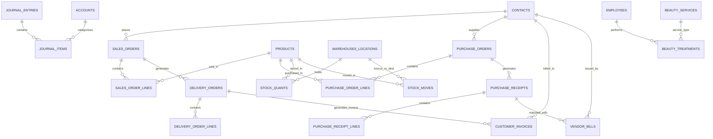

# SEED DATASET & DATA MODEL SPECIFICATION
**Proyek:** ERP Web App — PT Arunika Beauty Nusantara (NusaGlow)  
**Dokumen:** Spesifikasi Basis Data & Dataset Baseline Terverifikasi  
**Versi:** 1.0 (Baseline Pristine)  
**Terkait:** `ANGGOTA_1_COMPLETION_REPORT.md`, `DECISION_LOG.md`, `TEST_REPORT.md`  

---

## 1. Ringkasan Eksekutif & Angka Kontrol Finansial

Dataset baseline dirancang untuk mencerminkan kondisi awal operasional PT Arunika Beauty Nusantara per 1 Januari 2026 sebelum ada transaksi skenario baru:

| Parameter Baseline | Nilai Finansial / Kuantitas | Keterangan Akuntansi |
| :--- | :--- | :--- |
| **Kas / Saldo Bank (Akun 1010)** | **Rp50.000.000** | Rekening operasional utama di Bank |
| **Piutang Usaha / AR (Akun 1100)** | **Rp4.440.000** | C002 (Rp222.000) + C003 (Rp4.218.000) |
| **Valuasi Persediaan (Akun 1200)** | **Rp22.612.500** | 396 unit produk kosmetik fisik |
| **Utang Usaha / AP (Akun 2100)** | **Rp2.220.000** | Saldo utang pemasok ke V01 PT Bumi Dermalab |
| **Modal Awal / Equity (Akun 3100)** | **Rp74.832.500** | Modal disetor penyeimbang aktiva |
| **Total Debit & Total Kredit** | **Rp77.052.500** | Jurnal Pembuka `JE/2026/OPENING` (Seimbang) |

---

## 2. Diagram Relasi Entitas (Entity-Relationship Data Model)

---

## 3. Master Data Pelanggan (6 Customers)

| ID | Nama Pelanggan | Tipe | Kota | Credit Limit | Payment Terms | Opening AR |
| :---: | :--- | :--- | :--- | :---: | :---: | :---: |
| **C001** | Ayu Prameswari | Perorangan | Jakarta | Rp2.000.000 | Net 14 | Rp0 |
| **C002** | Nadira Putri | Perorangan | Bandung | Rp500.000 | Net 14 | Rp222.000 |
| **C003** | PT Anggun Sejahtera | Perusahaan | Jakarta | Rp8.000.000 | Net 30 | Rp4.218.000 |
| **C004** | Rani Kartika | Perorangan | Depok | Rp1.200.000 | Immediate | Rp0 |
| **C005** | Dewi Natalia | Perorangan | Bekasi | Rp1.000.000 | Net 14 | Rp0 |
| **C006** | CV Cantik Bersama | Perusahaan | Bandung | Rp4.000.000 | Net 30 | Rp0 |

---

## 4. Master Data Pemasok / Vendor (4 Vendors)

| ID | Nama Vendor | Tipe | Kota | Payment Terms | Opening AP | Lead Time |
| :---: | :--- | :--- | :--- | :---: | :---: | :---: |
| **V01** | PT Bumi Dermalab | Perusahaan | Jakarta | Net 30 | Rp2.220.000 | 7 Hari |
| **V02** | CV Aura Kosmetika | Perusahaan | Bandung | Net 14 | Rp0 | 7 Hari |
| **V03** | PT Proteksi Kulit | Perusahaan | Bogor | Net 30 | Rp0 | 7 Hari |
| **V04** | CV Natura Indah | Perusahaan | Jakarta | Net 14 | Rp0 | 7 Hari |

---

## 5. Master Data Produk & Daftar Harga (15 SKUs Kosmetik)

| Variant SKU | Nama Produk | Ukuran | Warna | Satuan | Harga Jual | HPP / Cost | Vendor Default |
| :--- | :--- | :--- | :--- | :---: | :---: | :---: | :---: |
| `BC-CLN-100` | Gentle Cleanser | 100 ml | Bening | botol | Rp120.000 | Rp60.000 | V01 |
| `BC-TON-100` | Hydrating Toner | 100 ml | Bening | botol | Rp150.000 | Rp70.000 | V01 |
| `BC-SER-030` | Glow Serum | 30 ml | Amber | botol | Rp90.000 | Rp45.000 | V02 |
| `BC-MSK-001` | Facial Treatment Mask | 1 sachet | Putih | sachet | Rp85.000 | Rp40.000 | V02 |
| `BC-SCR-050` | Face Scrub | 50 ml | Putih | jar | Rp110.000 | Rp55.000 | V01 |
| `BC-SPF-050` | Daily Sunscreen SPF50 | 50 ml | Krem | tube | Rp130.000 | Rp65.000 | V03 |
| `BC-CRM-050` | Day Cream | 50 g | Putih | jar | Rp165.000 | Rp82.500 | V03 |
| `BC-CRM-051` | Night Cream | 50 g | Ungu | jar | Rp175.000 | Rp87.500 | V03 |
| `BC-LIP-001` | Lip Balm Rose | 10 g | Rose | tube | Rp65.000 | Rp30.000 | V04 |
| `BC-LIP-002` | Lip Balm Coral | 10 g | Coral | tube | Rp65.000 | Rp30.000 | V04 |
| `BC-HAI-100` | Hair Serum | 100 ml | Amber | botol | Rp145.000 | Rp72.000 | V02 |
| `BC-SHA-250` | Gentle Shampoo | 250 ml | Bening | botol | Rp95.000 | Rp47.000 | V04 |
| `BC-CND-250` | Hair Conditioner | 250 ml | Putih | botol | Rp105.000 | Rp52.000 | V04 |
| `BC-BDY-200` | Body Lotion | 200 ml | Putih | botol | Rp115.000 | Rp57.000 | V01 |
| `BC-MST-100` | Body Mist | 100 ml | Pink | botol | Rp125.000 | Rp62.000 | V04 |

---

## 6. Lokasi Gudang & Stok Baseline (396 Unit Fisik)

Perseroan memiliki 2 lokasi fisik:
1. `WH-JKT`: Gudang Pusat (Jakarta) — Distribusi ritel dan pasokan
2. `ST-BDG`: Glow Studio / Salon (Bandung) — Layanan perawatan kecantikan

| SKU Produk | WH-JKT (Gudang) | Reserved WH-JKT | ST-BDG (Studio) | Total Fisik | Total Nilai Stok |
| :--- | :---: | :---: | :---: | :---: | :---: |
| `BC-CLN-100` | 15 | 3 *(S00006)* | 8 | 23 | Rp1.380.000 |
| `BC-TON-100` | 17 | 0 | 9 | 26 | Rp1.820.000 |
| `BC-SER-030` | 19 | 0 | 10 | 29 | Rp1.305.000 |
| `BC-MSK-001` | 15 | 0 | 11 | 26 | Rp1.040.000 |
| `BC-SCR-050` | 17 | 0 | 8 | 25 | Rp1.375.000 |
| `BC-SPF-050` | 19 | 0 | 9 | 28 | Rp1.820.000 |
| `BC-CRM-050` | 15 | 0 | 10 | 25 | Rp2.062.500 |
| `BC-CRM-051` | 17 | 0 | 11 | 28 | Rp2.450.000 |
| `BC-LIP-001` | 19 | 0 | 8 | 27 | Rp810.000 |
| `BC-LIP-002` | 15 | 0 | 9 | 24 | Rp720.000 |
| `BC-HAI-100` | 17 | 0 | 10 | 27 | Rp1.944.000 |
| `BC-SHA-250` | 19 | 0 | 11 | 30 | Rp1.410.000 |
| `BC-CND-250` | 15 | 0 | 8 | 23 | Rp1.196.000 |
| `BC-BDY-200` | 17 | 0 | 9 | 26 | Rp1.482.000 |
| `BC-MST-100` | 19 | 0 | 10 | 29 | Rp1.798.000 |
| **TOTAL** | **255 unit** | **3 unit** | **141 unit** | **396 unit** | **Rp22.612.500** |

---

## 7. Bagan Akun Standar (Chart of Accounts — COA)

| Kode Akun | Nama Akun | Tipe | Saldo Normal | Keterangan Penggunaan |
| :---: | :--- | :--- | :---: | :--- |
| **1010** | Bank | Asset | Debit | Rekening operasional utama |
| **1100** | Accounts Receivable (Piutang) | Asset | Debit | Piutang pelanggan ritel & salon |
| **1150** | Input VAT (PPN Masukan) | Asset | Debit | Pajak pembelian dari pemasok |
| **1200** | Stock Valuation (Persediaan) | Asset | Debit | Nilai persediaan fisik |
| **1250** | Stock Interim Received | Asset | Debit | Akun perantara Three-Way Match |
| **2100** | Accounts Payable (Utang) | Liability | Credit | Utang usaha ke vendor kosmetik |
| **2150** | Output VAT (PPN Keluaran) | Liability | Credit | PPN efektif 11% faktur penjualan |
| **3100** | Opening Capital (Modal Awal) | Equity | Credit | Modal disetor pemilik perusahaan |
| **4000** | Sales Revenue | Income | Credit | Pendapatan penjualan produk skincare |
| **4010** | Service Revenue | Income | Credit | Pendapatan jasa perawatan salon |
| **5000** | Cost of Goods Sold (BPP) | Expense | Debit | Beban pokok pengeluaran barang |
| **5010** | Treatment Consumables | Expense | Debit | Konsumsi bahan studio (masker) |
| **6000** | Operating Expense | Expense | Debit | Beban umum operasional |
| **6100** | Bank Fees | Expense | Debit | Beban administrasi bank |
| **9999** | Opening Balance Clearing | Equity | Credit | Akun kliring saldo awal |

---

## 8. Master Karyawan & Matriks Skill Studio

| ID | Nama Karyawan | Posisi | Penempatan | Keahlian (*Skills*) | Status |
| :---: | :--- | :--- | :--- | :--- | :---: |
| **E001** | Sinta Maharani | Beauty Therapist | Studio Bandung | `['Facial']` | Aktif |
| **E002** | Rizka Amalia | Beauty Therapist | Studio Bandung | `['Hair Treatment']` | Aktif |
| **E003** | Gita Lestari | Supervisor | Studio Bandung | `['Facial', 'Hair Treatment']` | Aktif |
| **E004** | Fajar Wijaya | Stock Operator | Gudang Jakarta | `['Stock Handling']` | Aktif |

---

## 9. Master Layanan Studio Kecantikan

| ID Layanan | Nama Perawatan | Durasi | Tarif Jasa | Bahan Terkonsumsi | Qty / Sesi | Skill Wajib |
| :---: | :--- | :---: | :---: | :--- | :---: | :---: |
| **`SV-FAC-01`** | Glow Facial | 60 menit | Rp300.000 | `BC-MSK-001` (Facial Mask) | 1 sachet | `Facial` |

---

## 10. Dokumen Transaksi Awal Baseline

1. **`LEAD-0001`**: Prospek CRM atas nama **PT Anggun Sejahtera** (`C003`), Salesperson Kevin Mahendra, Status: Lead (Stage: New).
2. **`S00006`**: Sales Order Confirmed atas nama **Dewi Natalia** (`C005`), memesan 3 botol `BC-CLN-100` di WH-JKT. Total Rp399.600 (Untaxed Rp360.000 + PPN Rp39.600). Mengunci reservasi 3 unit di WH-JKT.
3. **`PO00006`**: Purchase Order Confirmed & Locked kepada **CV Aura Kosmetika** (`V02`), memesan 8 botol `BC-SER-030`. Total Rp399.600 (Untaxed Rp360.000 + PPN Rp39.600).
4. **`TRT/2026/00007`**: Layanan perawatan Glow Facial dijadwalkan untuk **Rani Kartika** (`C004`) oleh terapis **Sinta Maharani** (`E001`).

